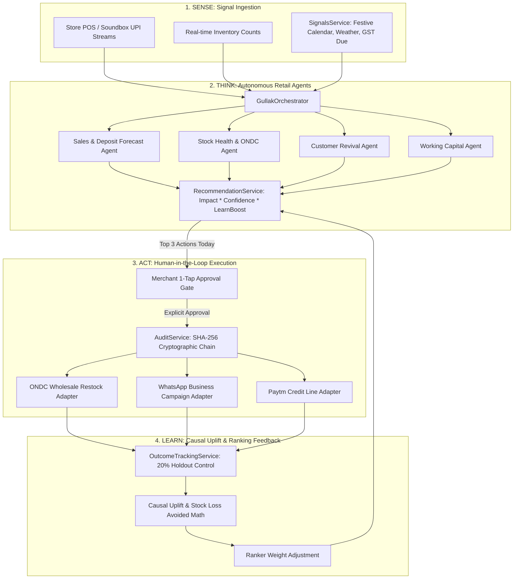

# Gullak AI: Comprehensive Technical Architecture

## 1. System Architecture Overview

Gullak AI is architected as an autonomous retail intelligence platform operating on a closed loop of **Sense &rarr; Think &rarr; Act &rarr; Learn**.



---

## 2. Frontend Surface Mapping (5 Surfaces)

The frontend architecture condenses 19 legacy enterprise pages into 5 merchant-mental-model surfaces:

| Surface | Primary Route | Drill-Down Views Preserved | Mental Model Question |
| :--- | :--- | :--- | :--- |
| **१. आज (Aaj)** | `/aaj` (`dashboard`) | Today's Sales, Deposit Split, Top 3 Actions, Extra Earnings | *"What happened today and what should I do right now?"* |
| **२. विचारा (Vichara)** | `/vichara` (`voice`) | Multilingual Voice & Text Assistant, Intent Chips | *"Can I ask my assistant in my mother tongue?"* |
| **३. क्रिया (Kriya)** | `/kriya` (`approvals`) | Waiting for you, Done & In Progress, Results, Advanced Audit | *"What needs my approval and what were the verified results?"* |
| **४. ग्राहक (Grahak)** | `/grahak` (`customers`) | 4-step Bring-Back Journey (Segment &rarr; Campaign &rarr; Approve &rarr; Results) | *"Who stopped coming and how do I bring them back?"* |
| **५. माल आणि पैसा (Maal & Paisa)** | `/maal_paisa` (`inventory`) | Stock Tab (Low Stock & ONDC) + Money Tab (Sales, UPI, Working Capital) | *"What stock is finishing and how much working capital do I have?"* |

---

## 3. The 3-Part Answer Format
Every conversational response and recommendation produced by Gullak AI follows a strict cognitive model:
1. **What Happened:** Concrete, grounded fact (e.g., *"Today's sales are ₹40,717 from 42 transactions."*)
2. **What It Means:** Plain-language context without statistical jargon (e.g., *"Pure Desi Ghee will run out on Thursday before Diwali Dhanteras."*)
3. **What To Do Next:** An actionable recommendation ready for 1-tap approval (e.g., *"Reorder 45 Litres via ONDC wholesale for ₹21,600."*)

---

## 4. Multi-Tenant Cryptographic Audit Trail

Every state-changing action executed by Gullak AI is recorded in a tamper-evident hash chain:
$$H_0 = \text{SHA256}(\text{"GENESIS"} \ || \ \text{timestamp})$$
$$H_i = \text{SHA256}(H_{i-1} \ || \ \text{action\_type} \ || \ \text{payload\_json} \ || \ \text{merchant\_id} \ || \ \text{approved\_by})$$

### Guarantees:
- **Non-repudiation:** No action can be taken without merchant consent record.
- **Tamper Detection:** Modifying any historical row's rupee amount or status invalidates all downstream hash pointers, detectable in $O(N)$ time via `/api/audit/verify`.
- **Shopkeeper UX:** Complex hashes and cryptographic proofs are secluded under the "Advanced" drawer in Kriya, presenting only green verified badges to the shopkeeper.

---

## 5. Indic Voice Pipeline & Grounding Rail

```
[ Merchant Audio Input (Web Audio API / Soundbox Mic) ]
                     │
                     ▼
          [ Sarvam AI / Indic ASR ]
          Streaming speech-to-text in MR, HI, EN
                     │
                     ▼
       [ IndicIntentDetector (SLM + Regex) ]
       Extracts intent + entities (e.g. TODAY_SALES, LOW_STOCK)
                     │
                     ▼
       [ GullakOrchestrator + Database Context ]
       Fetches verified figures from SQLite / PostgreSQL
                     │
                     ▼
       [ NumberGroundingValidator ]
       AST validation: asserts that every rupee/count figure in the
       generated response matches the database query exactly.
                     │
                     ▼
          [ Sarvam AI / Indic TTS ]
          Audio playback in regional accent (< 40 words)
```
