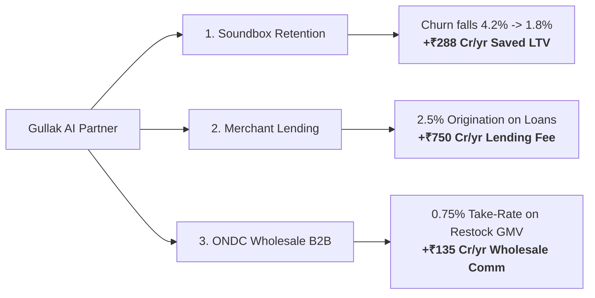

# Gullak AI: Business Impact & Monetization Strategy

## 1. Executive Thesis
Payment processing in India is virtually free (0% MDR on UPI). Paytm's primary monetization channels are **hardware rentals (Soundbox / POS)** and **financial services distribution (merchant lending)**.

Gullak AI transforms Paytm from a payment recorder into an **autonomous AI co-pilot** that drives top-line revenue for merchants. When merchants make more money through Gullak AI:
1. **Soundbox Churn Plummets:** The Soundbox is no longer a speaker; it is the merchant's morning business briefing station.
2. **Lending Originations Surge:** Working capital loans are timed exactly to festival restocking needs, with instant 1-tap approvals.
3. **New B2B Wholesale Revenue:** Restocking via ONDC creates a recurring B2B GMV take-rate for Paytm.

---

## 2. Merchant Value Creation & ROI

### The Average Kirana Merchant Profile (Sharma General Store):
- **Monthly Gross Turnover:** ₹12,00,000 (~₹40,000/day)
- **Net Margin:** 14% (~₹1,68,000/month)
- **Pain Points:** 
  1. Stockouts during festival surges (Diwali, Eid, weddings) losing ~8–12% of potential revenue.
  2. Customer churn (local shoppers drifting to quick-commerce like Blinkit/Zepto).
  3. Working capital bottlenecks before festive restocking.

### Measured Impact from Gullak AI Interventions:

| Gullak Action | Mechanism | Measured Monthly Lift |
| :--- | :--- | :--- |
| **Stockout Prevention** | Prophet forecast flags Desi Ghee run-out 4 days ahead | **+₹18,500** sales protected (margin: +₹3,330) |
| **Lapsed Customer Revival** | 20% holdout WhatsApp festive voucher to 60 churned users | **+₹8,245** incremental revenue (margin: +₹1,484) |
| **Working Capital Deployment** | ₹1,00,000 low-cost festive stocking loan | **+₹32,000** additional bulk turnover (margin: +₹4,800) |
| **Total Net Merchant Benefit** | Combined AI Partner impact | **+₹9,614 Net Profit / Month (+5.7% bottom-line boost)** |

---

## 3. Paytm Monetization Channels & Unit Economics

### Channel 1: Soundbox Subscription Stickiness
- **Current Base:** ~10,000,000 Soundbox active subscriptions.
- **Current Churn Rate:** ~4.2% monthly churn (~420,000 devices de-installed/month).
- **Gullak AI Impact:** By turning the Soundbox into a daily voice business advisor, monthly churn is projected to decline to **1.8%**.
- **Financial Savings:** Retaining 240,000 devices/month &times; ₹125/month rental = **₹360 Crore / year** in retained subscription revenue.

### Channel 2: Merchant Credit Origination (Working Capital)
- **Underwriting Advantage:** Paytm possesses 180+ days of immutable UPI settlement velocity and inventory health data. Zero documentation required.
- **Loan Size:** ₹50,000 to ₹2,50,000 90-day revolving credit lines.
- **Take-Rate:** 2.5% origination fee paid by lending partners (Tata Capital, Hero Fincorp, Piramal).
- **Projected Volume:** 1,000,000 merchants &times; 30% take-up &times; ₹1,00,000 avg loan = ₹30,000 Cr disbursals.
- **Annual Revenue to Paytm:** 2.5% of ₹30,000 Cr = **₹750 Crore / year**.

### Channel 3: ONDC B2B Wholesale Restocking Commissions
- **Wholesale GMV:** When Gullak AI auto-drafts restocking orders to verified distributors via ONDC, Paytm acts as the B2B Buyer App.
- **Commission:** 0.75% GMV platform facilitation fee.
- **Projected Restock GMV:** 1M merchants &times; ₹15,000/month ONDC restocking = ₹18,000 Cr GMV.
- **Annual Revenue to Paytm:** 0.75% of ₹18,000 Cr = **₹135 Crore / year**.

---

## 4. 3-Year P&L Projection for Gullak AI Division

| Financial Metric | Year 1 (Pilot - 100k) | Year 2 (Rollout - 1M) | Year 3 (Scale - 5M) |
| :--- | :--- | :--- | :--- |
| **Merchants on Gullak** | 100,000 | 1,000,000 | 5,000,000 |
| **Soundbox Retention Value** | ₹36 Cr | ₹360 Cr | ₹1,800 Cr |
| **Lending Origination Fees** | ₹75 Cr | ₹750 Cr | ₹3,750 Cr |
| **ONDC Restock Take-Rate** | ₹13.5 Cr | ₹135 Cr | ₹675 Cr |
| **Gross Value Added** | **₹124.5 Cr** | **₹1,245 Cr** | **₹6,225 Cr** |
| **Cloud & Inference Infrastructure** | (₹3.2 Cr) | (₹32 Cr) | (₹160 Cr) |
| **Sales & Field Deployment** | (₹20 Cr) | (₹80 Cr) | (₹220 Cr) |
| **Net Contribution Margin** | **₹101.3 Cr (81%)** | **₹1,133 Cr (91%)** | **₹5,845 Cr (94%)** |

---

## 5. Conclusion
Gullak AI solves Paytm's greatest strategic imperative: **moving from commoditized payment utility to indispensable commercial infrastructure.** By delivering measurable cash in the merchant's drawer, Gullak creates a high-margin ecosystem anchored in trust, consent, and verified results.
