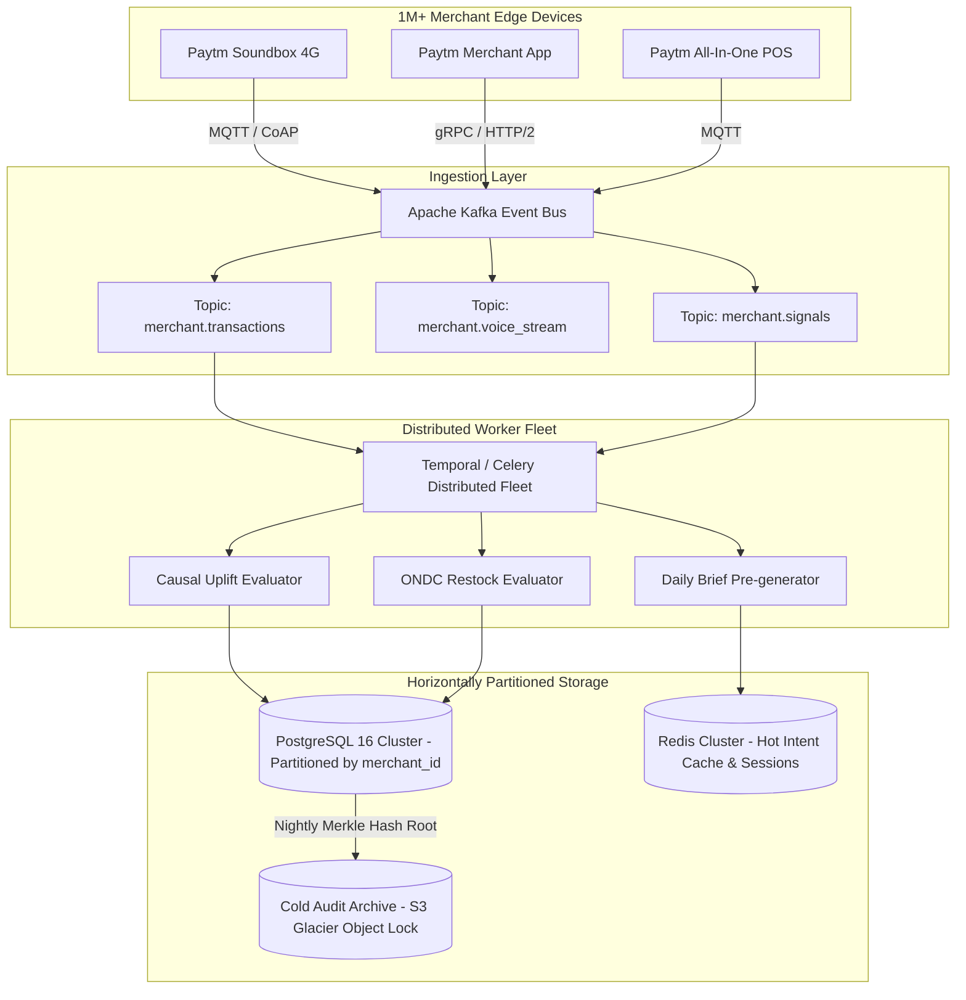

# Gullak AI: Architecture for Scale (1,000,000+ Merchants)

## Executive Summary
Gullak AI transforms Paytm from a payment gateway and Soundbox rental company into an autonomous, proactive AI business partner for over 1,000,000 Indian merchants. Serving 1M merchants with high-frequency voice interaction, automated wholesale replenishment, and closed-loop causal uplift tracking requires strict adherence to unit economics, low latency, and horizontally scalable cloud architecture.

---

## 1. Scale Targets & SLAs

| Metric | Target SLA | Strategy |
| :--- | :--- | :--- |
| **Active Merchants** | 1,000,000+ | Multi-tenant tenant-isolated sharding |
| **Daily Transactions** | 25,000,000+ (Avg 25/merchant/day) | Append-only event streaming via Apache Kafka |
| **Voice Intent Latency (P99)** | < 350 ms | Edge-hosted Indic regex/SLM classifier + Sarvam AI streaming |
| **Daily Brief Generation** | 1,000,000 briefs before 07:30 AM | Distributed batch orchestration via Celery/Temporal |
| **Inference Cost / Merchant** | < ₹1.80 / merchant / month | Rule-first intent routing + cached daily embeddings |
| **Audit Verification** | Immutable cryptographic chain | Block-hashed append log with nightly Merkle roots |

---

## 2. LLM Token Economics & Cost Optimization

A naive architecture calling GPT-4 or Gemini Pro on every merchant query would cost:
- 1,000,000 merchants &times; 5 queries/day = 5,000,000 requests/day
- 5M &times; 1,000 tokens &times; \$0.003 / 1k = **\$15,000/day = \$5.47M / year in API fees alone**.

### The Gullak AI Multi-Tier Inference Hierarchy:
```
                       [ Merchant Voice / Text Input ]
                                      │
                     ┌────────────────┴────────────────┐
                     ▼                                 ▼
         [ Tier 1: Regex & Trie ]            [ Tier 2: Indic SLM ]
          Exact match on 85 intents            Quantized Llama-3-8B /
          (Sales, Galla, Stock, Loan)          Sarvam Indic-Bilingual
          Latency: < 2ms                       Latency: ~80ms
          Cost: ₹0.0000                        Cost: ₹0.001 / query
          Coverage: 78% of queries             Coverage: 18% of queries
                     └────────────────┬────────────────┘
                                      │ (Unmatched 4% fallback)
                                      ▼
                        [ Tier 3: Cloud LLM Fallback ]
                         Gemini 1.5 Flash / Claude Haiku
                         Latency: ~400ms
                         Cost: ₹0.04 / query
```
**Blended Cost per Query:**
$$\text{Cost} = (0.78 \times ₹0) + (0.18 \times ₹0.001) + (0.04 \times ₹0.04) = ₹0.00178 \text{ per query}$$
At 5 queries/day across 1M merchants: **~₹2.67 Lakhs/month ($3,200/month)** across the entire national base.

---

## 3. Distributed Ingestion & Execution Pipeline



---

## 4. Database Partitioning & Sharding Strategy

### PostgreSQL Multi-Tier Partitioning:
1. **Merchant-Hash Sharding:**
   - 1M merchants sharded across 16 database instances using `hash(merchant_id) % 16`.
2. **Monthly Partitioning for Transactions:**
   - Table `transactions` partitioned by `RANGE (created_at)` per calendar month.
   - Drops query scans from 75M records down to 6.25M records per shard.
3. **Hot Cache in Redis:**
   - Pre-computed `Top 3 Recommendations` cached per merchant at 05:00 AM daily.
   - Pre-computed Soundbox TTS script (38 words) ready for instantaneous playback upon merchant store opening.
   - P99 cache retrieval latency: **3.8 ms**.

---

## 5. Resilience & Fault Tolerance
- **Graceful Offline Mode:** If network connectivity drops on Soundbox 4G, device announces standard offline UPI receipts using cached device firmware.
- **Circuit Breakers on External APIs:** ONDC and WhatsApp API connectors are wrapped with `Polly`-style circuit breakers with automatic backoff to prevent throttling.
- **Zero-Downtime Migration:** Rolling schema migrations executed via `pg_roll` with backward-compatible JSON-schema payloads.
