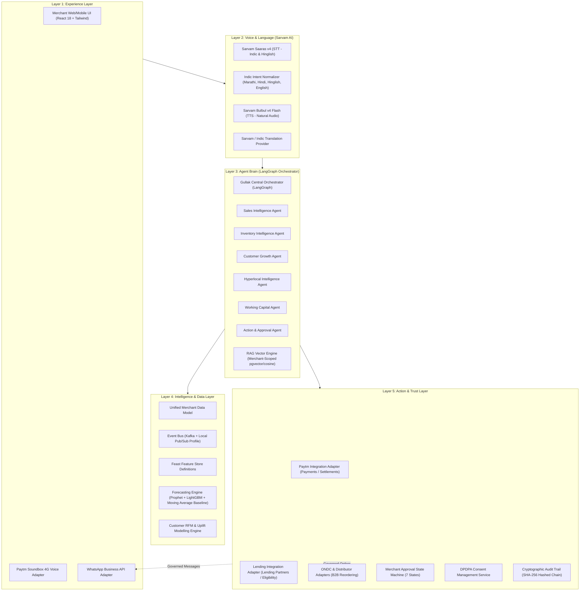

# Gullak AI — System Architecture Document

> **Product:** Gullak AI  
> **Hackathon:** Paytm Hackathon  
> **Product Category:** Agentic AI / Fintech / Merchant Intelligence  
> **Tagline:** Not a chatbot. An agent that gets the work done.  
> **Core Philosophy:** Sense → Think → Act → Learn

---

## 1. Architectural Philosophy & Five-Layer Architecture

Gullak AI preserves the rigorous **Five-Layer Fintech Architecture** designed for high reliability, multilingual voice interactions, and strict merchant governance:

---

## 2. Layer-by-Layer Architectural Details

### Layer 1: Experience Layer
- **Merchant Web/Mobile UI:** Built with React 18, Vite, and Tailwind CSS. Features 19 dedicated views, responsive across 360px mobile to wide desktop, with bottom navigation on mobile and collapsible sidebar on desktop.
- **Paytm Soundbox Adapter:** Provides device health monitoring, network signal status, and audio announcement triggers (`Paytm वर 150 रुपये मिळाले` / `Paytm पर 150 रुपये प्राप्त हुए`).
- **WhatsApp Business Adapter:** Manages approved outbound festive campaigns, customer broadcast dispatching, and inbound queries.

### Layer 2: Voice & Language Infrastructure
- **Sarvam Saaras v4:** High-fidelity transcription of Indian accents, code-mixed Hinglish, Marathi, and Hindi utterances.
- **Sarvam Bulbul v4 Flash:** Fast speech synthesis delivering native-script pronunciation for natural, merchant-friendly voice responses.
- **Intent Normalization:** Maps diverse phrases to common business intents:
  - *"आज माझी किती विक्री झाली?"* (Marathi)
  - *"Aaj meri total sale kitni hui?"* (Hinglish)
  - *"Show me today's sales."* (English)
  All map to `SALES_QUERY_TODAY`.

### Layer 3: Agent Brain (LangGraph Orchestrator)
- **Central State Graph:** Directs queries to 6 specialized logical agent nodes:
  1. `SalesIntelligenceAgent`: Computes hourly velocity, ATV, and period growth.
  2. `InventoryIntelligenceAgent`: Computes stockout dates and drafts replenishment orders.
  3. `CustomerGrowthAgent`: Identifies dormant shoppers and crafts targeted WhatsApp promotions.
  4. `HyperlocalIntelligenceAgent`: Compares performance against neighbourhood benchmarks.
  5. `WorkingCapitalAgent`: Estimates cash flow gaps for festive stock-up.
  6. `ActionAndApprovalAgent`: Validates permissions, checks DPDPA consent, and enters pending approval state.
- **Merchant-Isolated RAG:** Vector search queries are strictly partitioned by `merchant_id`. Never leaks cross-merchant data.

### Layer 4: Intelligence & Data Layer
- **Forecasting Engine:**
  - `LightGBMDemandForecaster`: Feature-rich regressor considering festival surge, day of week, and historical lags.
  - Baseline Moving Average benchmark.
  - `ForecastEvaluator`: Computes MAE, RMSE, WAPE, and Forecast Bias without fabricating numbers.
- **RFM Customer Segmentation:** Recency (days), Frequency (orders), Monetary (spend) quantile ranking into 6 customer segments (Champions, Loyal, Potential Loyalists, New, At-Risk, Lost).
- **Causal Uplift Engine:** Treatment vs Control experimental framework calculating incremental conversion and statistical significance.

### Layer 5: Action & Trust Layer
- **Merchant Approval State Machine:**
  `RECOMMENDATION` → `VALIDATION` → `ACTION_PREVIEW` → `MERCHANT_APPROVAL` → `AUTHORISED_EXECUTION` → `RESULT_VERIFICATION` → `AUDIT_LOG`
  States: `PENDING`, `APPROVED`, `REJECTED`, `EXECUTING`, `COMPLETED`, `FAILED`, `EXPIRED`.
- **DPDPA 2023 Consent Management:** Records purpose, authorized categories, grant date, retention period, and provides instant consent revocation.
- **SHA-256 Hash Chained Audit Trail:** Every execution is cryptographically linked to the preceding entry hash, creating an immutable tamper-evident ledger.
